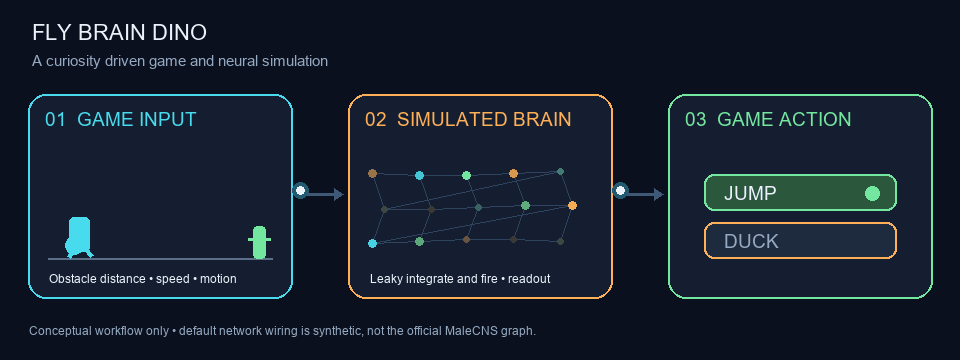

# Fly-Brain Dino

**A fruit-fly-inspired neural network learns to play a Chrome-style dinosaur game.**


**Languages:** Python  
**Technologies:** Pygame CE, NumPy, Pillow, Python's built-in argparse and collections  
**Inspiration and research references:** TuragaLab `flybody`, MuJoCo, and the MaleCNS v1.0 *Drosophila melanogaster* connectome project.

> This repository is a 2D Pygame prototype. The references above informed the project idea; the current code does not load the `flybody` MuJoCo body model or the official MaleCNS connection graph by default. See [Model and data scope](#model-and-data-scope) for details.

<p align="center">
  
</p>

## Overview

Fly-Brain Dino combines a side-scrolling dinosaur game with a leaky integrate-and-fire neural simulation. A rule-based coach demonstrates when to jump or duck, and a trainable readout learns to imitate those decisions. You can also play manually or let the trained readout control the dinosaur.

The default network is configured for **166,700 simulated units**. That is the project's configured size; it does not mean the current default wiring is the official 166,700-neuron MaleCNS connectome.

## Features

- Three modes: human play, coach-led learning, and neural readout control.
- A live brain panel that visualizes activity over a fruit-fly brain image.
- A spiking network with configurable neuron count and simulation substeps.
- Optional NPZ connectome input through `--connectome`.
- Save and reload of learned jump/duck readout weights.
- Cacti, birds, score progression, day/night palette changes, and keyboard controls.

## Quick start

### Requirements

- Windows with the Python launcher (`py`) available on PATH.
- Python 3.9 or newer.
- Internet access on the first launch so `run.bat` can install the packages in `requirements.txt`.

### Run on Windows

1. Download or clone this repository.
2. Double-click `run.bat`.
3. The game opens in learning mode. Use the controls below to switch modes.

Or run it from PowerShell:

```powershell
py -m pip install -r requirements.txt
py main.py
```

To use fewer simulation steps per game frame on a slower computer:

```powershell
py main.py --substeps 1
```

## Controls

| Key | Action |
|---|---|
| `1` | Human mode (`Space` / `Up` to jump, `Down` to duck) |
| `2` | Learning mode: the coach controls the game while the readout trains |
| `3` | Neural readout control |
| `P` | Toggle plasticity while the neural readout controls the game |
| `B` | Toggle birds |
| `F` | Toggle 4× fast-forward |
| `R` | Restart the game |
| `S` | Save learned readout weights |
| `Esc` | Quit; the latest readout weights are saved on exit |

## How learning works

1. The game converts nearby obstacle and dinosaur state into normalized input features.
2. Population-coded inputs stimulate sensory units in the simulated network.
3. A leaky integrate-and-fire update advances the network and its activity rates.
4. A linear readout produces `JUMP` and `DUCK` values.
5. In learning mode, a hand-written coach supplies target actions and the readout weights are adjusted to imitate them.
6. In neural mode, the readout actions control the dinosaur; plasticity can remain enabled for further adaptation.

The coach supplies the teaching signal. The project is an educational simulation and does not demonstrate a fruit fly discovering the game or learning independently from biological experience.

## Model and data scope

### Fly body and MuJoCo references

The project idea is inspired by [TuragaLab's `flybody`](https://github.com/TuragaLab/flybody), an anatomically detailed fruit-fly body model and locomotion task suite for MuJoCo, developed by Google DeepMind and HHMI Janelia Research Campus. [MuJoCo](https://github.com/google-deepmind/mujoco) is the physics engine used by that upstream project.

The game in this repository is currently implemented with Pygame's 2D drawing and collision logic. It does **not** import `flybody`, load its MJCF model, or run MuJoCo physics. The FlyBody and MuJoCo links are upstream references, not dependencies of this game.

### Male fly CNS connectome

The [MaleCNS project](https://male-cns.janelia.org/) provides the MaleCNS v1.0 connectome for the adult male *Drosophila melanogaster* central nervous system. The project is a collaboration involving FlyEM at HHMI Janelia, the University of Cambridge, the MRC Laboratory of Molecular Biology, and Google Research. The dataset is made available under [CC BY](https://creativecommons.org/licenses/by/4.0/).

This repository's default wiring is **synthetic**. `brain_weights.npz` contains learned action-readout weights; it is not the MaleCNS connectivity dataset. The code can accept a separately prepared `.npz` graph with `pre`, `post`, and `weight` arrays (and optional `sign`) using `--connectome`, but this project does not include the official graph or a converter for the official MaleCNS download. Therefore, the default run should be described as connectome-inspired/sized, not as a simulation using official MaleCNS synaptic wiring.

Example command for a compatible graph file:

```powershell
py main.py --neurons <neuron_count> --connectome path\to\connectome.npz
```

The graph file's neuron IDs must correspond to the neuron count passed with `--neurons`. The loader and format should be checked against the particular dataset export before scientific use.

## Project files

```text
fly_dino/
├── assets/                 # Brain image and game sprite references
├── docs/
│   └── brain-game-loop.gif # Animated conceptual workflow diagram
├── brain_view.py           # Brain image and activity visualization
├── brain_weights.npz       # Saved action-readout weights
├── dino_game.py            # Pygame game, obstacles, physics, and coach
├── fly_brain.py            # Spiking network, readout, training, and graph loader
├── main.py                 # Application entry point and UI
├── requirements.txt        # Python dependencies
└── run.bat                 # Windows setup and launch helper
```

## Configuration

```text
--neurons N          Simulated neuron count (default: 166700)
--connectome PATH    Compatible NPZ connection graph
--substeps N         Network steps per game frame (default: 2)
--visual-fps N       Brain panel refresh rate; 0 refreshes every frame
--weights PATH       Readout weight file
--image PATH         Brain background image
--no-birds           Start with birds disabled
--seed N             Set the game seed
```

For all options, run `py main.py --help`.

## Credits and references

- **Fly-body model inspiration:** [TuragaLab/flybody](https://github.com/TuragaLab/flybody), developed in collaboration by Google DeepMind and HHMI Janelia Research Campus. See the [FlyBody publication](https://doi.org/10.1038/s41586-025-09029-4).
- **Physics engine reference:** [Google DeepMind MuJoCo](https://github.com/google-deepmind/mujoco).
- **Connectome data reference:** [MaleCNS Connectome Project](https://male-cns.janelia.org/), dataset `male-cns:v1.0`; see the [download and data documentation](https://male-cns.janelia.org/download/).
- **Game and neural simulation code:** this repository.

The upstream repositories and connectome dataset retain their own licenses and attribution terms. This repository does not bundle the FlyBody code or the official MaleCNS graph.

## Limitations

- Synthetic wiring is used unless a compatible connectome NPZ is explicitly supplied.
- The coach is a hand-written rule; learning trains the readout to reproduce it.
- The Pygame game is a simplified 2D environment, not a MuJoCo body simulation.
- The optional connectome loader expects a prepared NPZ and has not been validated here against an official MaleCNS export.
- The bundled weights are a starting point and may behave differently after retraining or when game settings change.

## License

No license has been added for this project yet. Add a license before inviting others to reuse or redistribute this repository. The upstream FlyBody code and MaleCNS data have separate licenses; see their respective project pages.
